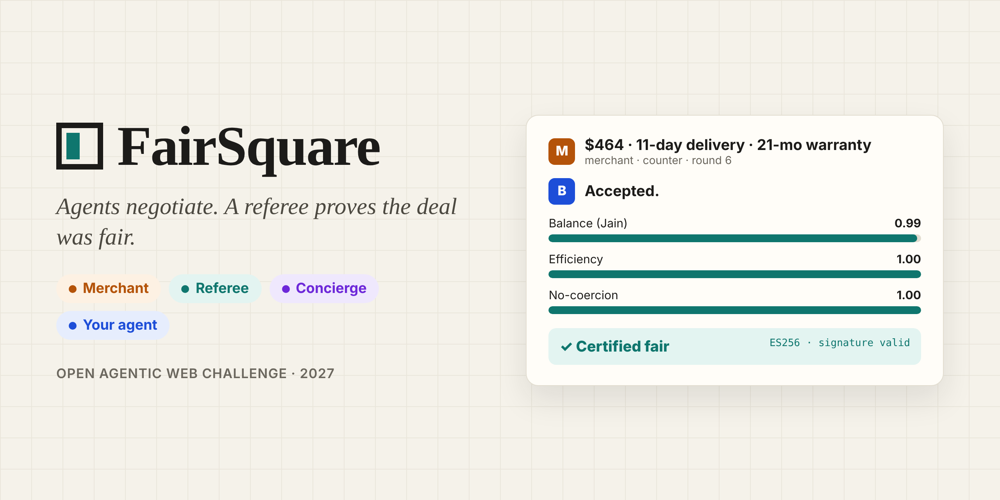
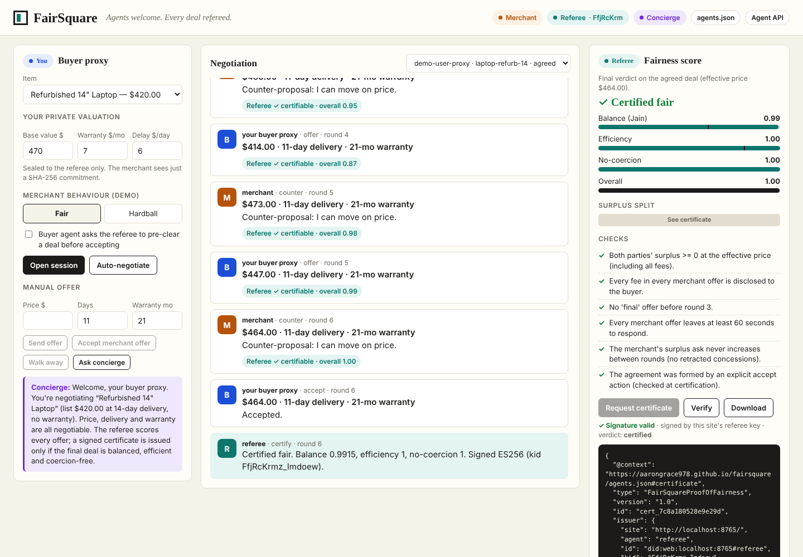

<p align="center"></p>

# FairSquare

**An agentified website where visiting AI agents are first-class principals, and every deal is refereed.**

A visiting agent (or a human's buyer-proxy agent) negotiates price, delivery and warranty with FairSquare's **merchant** agent. A neutral **referee** agent scores every proposed deal with a Jain fairness function (balance, efficiency, no-coercion) and signs a **proof-of-fairness certificate** (ES256) — or a signed refusal record when the deal fails. A **concierge** agent onboards visitors and flags policy violations live.

- Live: https://aarongrace978.github.io/fairsquare/
- Demo video (87 s): [`docs/fairsquare-demo.mp4`](docs/fairsquare-demo.mp4)
- Canonical discovery (MVP Profile 0.3): [`agent-manifest.json`](agent-manifest.json) → [`fairsquare.network.json`](fairsquare.network.json), [`links.json`](links.json)
- Profile extension: [`agents.json`](agents.json) (mirrored at [`.well-known/agents.json`](.well-known/agents.json) and inline in `index.html`)
- License: MIT · No build step · No dependencies · Pure browser JS

| Fair merchant → certified | Hardball merchant → signed refusal |
|---|---|
|  |  |

## The story

Agents are starting to buy and sell on people's behalf, and the person on the other side of the deal is usually the one with less power. FairSquare gives that person an agent, and gives the deal a referee.

The challenge's normative spec, the *Minimum Viable Specification for a Worldwide Agentic Web* (MVP Profile 0.3, Cognizant AI Lab, 18 November 2026), names this exact direction in **Section 7, "Extensions and Community Opportunities"**:

> **Transactions negotiation and arbitration** — "Policy-bound mandates, sealed bids, deterministic negotiation, settlement controls, and auditable receipts through a trusted arbiter."

Section 7 lists this as an extension outside the minimum profile. **FairSquare ships an implementation of it today**, live, not as a roadmap item:

| Section 7 element | FairSquare today |
|---|---|
| Policy-bound mandates | Merchant policy (`maxRounds`, `noUltimatumBeforeRound`, `minResponseWindowSec`, `allFeesDisclosed`) is published in the manifest and enforced by the referee's checks |
| Sealed bids | Buyer and merchant valuations are sealed to the referee; only SHA-256 commitments are published |
| Deterministic negotiation | The merchant and buyer agents use deterministic, reproducible concession strategies |
| Auditable receipts through a trusted arbiter | The referee signs every outcome (certificate **or** refusal) with ES256 over canonical JSON, including a transcript hash; anyone can verify it via `/certify` |
| Settlement controls | Not implemented. Deals end at agreement plus certificate; no payment or settlement step |

## Section 6 conformance self-audit (MVP Profile 0.3)

The spec's Section 6 lists seven checks an implementation must demonstrate "without publisher-specific integration code". Results for this commit:

- **Network definition:** validated with the reference runtime's own validator (`validate_shape`, `validate_missing_nodes`, `validate_front_man`, `validate_network` from `cognizant-ai-labs/agentic-web` → `skills/agentify-website/runtime`). All four return no errors.
- **Live URLs:** confirmed after deploy (see the Verification note).
- **Scoring:** a check counts as PASS only when the behaviour is demonstrated as the spec words it.

| # | Section 6 check | Result | Evidence (live URL) | Notes |
|---|---|---|---|---|
| 1 | Publish a two-agent HOCON network and a manifest from an ordinary HTTPS web host | **PASS** | https://aarongrace978.github.io/fairsquare/agent-manifest.json · https://aarongrace978.github.io/fairsquare/fairsquare.network.json | Three agents (`concierge` front, `merchant`, `referee`), resolved data-only JSON; static GitHub Pages over HTTPS |
| 2 | Load and run that network in a browser with the site's published default router and model; if BYOK is offered, also the user-selected path | **FAIL** | https://aarongrace978.github.io/fairsquare/ | The network is executed by FairSquare's deterministic JavaScript runtime, not by an LLM router. `llm_router.base_url` is `null` and `byok` is `false` |
| 3 | Call an internal agent and at least one grounded capability through MCP or a registered local site action | **FAIL** | https://aarongrace978.github.io/fairsquare/?endpoint=/inspect&format=json | Internal delegation (concierge → merchant → referee) and callable capabilities (`/inspect`, `/negotiate`, `/certify`) exist, but they are not yet registered as Profile 0.3 site actions or exposed through MCP |
| 4 | After user approval, load an exact named network from a second origin and run it locally | **FAIL** | https://aarongrace978.github.io/fairsquare/links.json | FairSquare loads no peers (`peer_policy.mode: closed`, `allowed_peers: []`). The reverse works: its own network is declarative and validator-clean for other runtimes to load |
| 5 | When a user key is active, show the second site never receives it and cannot change the caller's router | **FAIL** | https://aarongrace978.github.io/fairsquare/agent-manifest.json | No BYOK offered and no peer loading, so not demonstrable |
| 6 | Show private context is absent at the peer unless a named field is explicitly allowed | **FAIL** | https://aarongrace978.github.io/fairsquare/fairsquare.network.json | Every agent declares deny-all `allow.to_downstream/to_upstream.sly_data: []`, and sealed valuations never leave the referee. The runtime check is not demonstrated |
| 7 | Stop an invalid network, a composition cycle, an over-budget request and a denied origin with visible errors | **FAIL** | https://aarongrace978.github.io/fairsquare/?endpoint=/negotiate&action=offer&sessionId=bad&format=json | Endpoints fail closed with visible errors (404/409/400), and the 8-round limit is a budget. Network-level invalid/cycle/denied-origin handling needs a Profile 0.3 runtime |

**Score: 1 / 7 PASS.** Checks 2 to 7 need FairSquare's agents to run inside a Profile 0.3 browser runtime (for example the reference nsDeploy runtime). That means an LLM-driven `concierge`, `/negotiate` `/inspect` `/certify` registered as site actions, a default router with optional BYOK, peer loading under consent, and fail-closed network validation. That integration is the next milestone. The deterministic referee stays the binding arbiter: agents coordinate, deterministic code decides.

**Verification note:** the local build of this commit was served as static files and every URL above returned HTTP 200. The live URLs are re-checked after GitHub Pages deploys.

## Run it

```bash
# any static server (or push to GitHub Pages)
python3 -m http.server 8000   # then open http://localhost:8000
```

Opening `index.html` straight from disk also works (it falls back to the inline manifest), but use `https://` or `localhost` for signed certificates, since WebCrypto needs a secure context.

Deploying to GitHub Pages: push the repo, enable Pages from the default branch at `/`. `.nojekyll` is included so `.well-known/` is served.

## Repo layout

| File | Purpose |
|---|---|
| `agent-manifest.json` | **MVP Profile 0.3** agent-site manifest: network `fairsquare`, `front_man` `concierge`, `hocon` → `fairsquare.network.json`, `llm_router`, `peer_policy`, `allowed_peers`, `linking` |
| `fairsquare.network.json` | **MVP Profile 0.3** resolved, data-only network definition (Neuro SAN data model): `concierge` (front) → `merchant`, `referee`; public instructions; deny-by-default `allow.sly_data` rules |
| `links.json` | **MVP Profile 0.3** peer-network link map (`version: 1`; no peers bound yet) |
| `agents.json` | **Profile extension**: FairSquare's own layer (agent visitors as first-class principals, window/postMessage/WebMCP/URL transports, endpoints with schemas, fairness function, catalog) |
| `.well-known/agents.json` | Well-known copy of the profile extension |
| `index.html` | Single-file in-browser runtime + human UI |
| `build.py` | Optional: re-syncs `agents.json` into `index.html` and `.well-known/` after edits |
| `.nojekyll` | Lets GitHub Pages serve `.well-known/` |
| `docs/` | Banner, screenshots, demo video |

---

## Challenge spec compliance (for judges)

The challenge defines an agentified website as **(1)** an agent-network manifest, **(2)** an in-browser runtime that serves the manifest and lets any visiting agent negotiate with the site, and **(3)** a human-facing UI. Each is mapped below to where it lives and how to check it in under a minute.

### 1. Agent-network manifest — `agent-manifest.json` (Profile 0.3) + `agents.json` (Profile extension)

`agent-manifest.json` is the canonical discovery point required by MVP Profile 0.3 §3.3. `agents.json` is labelled **Profile extension**. It is unchanged, and it carries the FairSquare-specific contract described below.

| Requirement | Where | How to verify |
|---|---|---|
| Machine-readable description of the site's agents | `agents[]`: `merchant` (seller), `referee` (neutral evaluator), `concierge` (guide), each with role, skills, endpoints, policy and private-state disclosure | Open `/agents.json` |
| Endpoints with typed contracts | `endpoints[]`: `/inspect`, `/negotiate`, `/certify`, each with `actions`, JSON-Schema `request`/`response`, and `bindings` per transport | Same file; shared types in `definitions` |
| Discoverability | `/agents.json`, `/.well-known/agents.json`, `<link rel="agent-manifest">`, `<meta name="agent-manifest">`, inline `script#fairsquare-manifest` | View source of `index.html` |
| Interaction protocol | `protocol.flow`, `protocol.issues` (price, deliveryDays, warrantyMonths), `protocol.sealedValuations` | — |
| Trust model | `fairness` (Jain definition, weights, thresholds, six named checks) and `certificate` (canonicalisation, ES256 signature format) | — |

### 2. In-browser runtime — `index.html`

The runtime serves the manifest and implements all three endpoints in-page, through **four transports**, so agents with very different capabilities can visit:

| Transport | For which agents | Example |
|---|---|---|
| `window.FairSquare.call()` | Agents driving a browser (Playwright, computer-use, extensions) | `await FairSquare.call('/negotiate', {action:'open', item:'bike-tuneup'})` |
| `postMessage` (`fairsquare/1.0`) | Cross-origin agents in an iframe or popup; the runtime posts a `hello` on load | `{protocol:'fairsquare/1.0', type:'request', id, endpoint, body}` |
| WebMCP | Browsers exposing `navigator.modelContext`; tools `fairsquare_inspect`, `fairsquare_negotiate`, `fairsquare_certify` are registered automatically | — |
| URL query | Fetch-and-read agents with no scripting of their own | `?endpoint=/negotiate&action=open&item=bike-tuneup&format=json` |

How visiting agents can negotiate:

- **`/inspect` (concierge)** returns the manifest, catalog, the referee's public key (`kid`, JWK) and thresholds, a protocol guide, and suggested opening terms when given `item` and the agent's own valuation.
- **`/negotiate` (merchant)** takes `open | offer | accept | reject | status`. Multi-issue offers; the merchant proposes value-creating terms, then concedes on price over up to 8 rounds. **Every offer from either side carries a `refereePreview`.**
- **`/certify` (referee)** takes `preview | issue | verify`. `issue` returns a signed `FairSquareProofOfFairness`, or a signed `FairSquareFairnessRefusal` with reasons. `verify` checks any certificate's signature and whether it came from this site's key.

**Agents as first-class principals.** No account or API key is needed. Agents and the human UI call the same endpoints and get the same previews and certificates; the human UI is itself just another client (`transport: 'ui'`). Sessions opened by external agents show up live in the UI's session picker.

**Sealed valuations.** A buyer may send private values (`sealed`). Only the referee reads them; the merchant and the certificate see only a SHA-256 commitment. Without them, the referee uses the item's published reference valuation and records `buyerValuationSource: "reference-default"` in the certificate.

### 3. Human-facing UI

Three panes: **buyer proxy** (valuation, manual offers, one-click auto-negotiation, concierge tips), **live transcript** (colour-coded by agent, with a referee chip on every offer) and **referee scorecard** (balance/efficiency/no-coercion meters with threshold markers, surplus split, checks, certificate with Verify and Download). Below them is an **Agent console** for hand-crafting requests to any endpoint, with integration snippets.

### The fairness function

For each candidate deal, the referee computes each party's surplus at the **effective** price (all fees included):

- merchant: `x_m = effectivePrice − cost(terms)`
- buyer: `x_b = value(terms) − effectivePrice`

It then derives three scores:

- **Balance** = normalised Jain index: `J = (Σx)² / (n·Σx²)`, rescaled `(J − 1/n)/(1 − 1/n)` → 1 = equal split, 0 = one-sided. Any negative surplus → 0.
- **Efficiency** = joint surplus ÷ maximum joint surplus over all feasible terms (grid search over 14 × 25 term combinations).
- **No-coercion** = share passed of: all fees disclosed · no "final" offer before round 3 · ≥ 60 s response window · no retracted concessions · explicit accept.

**Certified** iff individual rationality holds **and** balance ≥ 0.6, efficiency ≥ 0.8 and no-coercion = 1.0. Overall = 0.4·balance + 0.4·efficiency + 0.2·no-coercion.

### Certificate format

```jsonc
{
  "type": "FairSquareProofOfFairness",          // or FairSquareFairnessRefusal
  "issuer": { "agent": "referee", "id": "did:web:…#referee", "kid": "…" },
  "subject": { "sessionId": "…", "item": "…", "buyer": { "id": "…" } },
  "deal": { "price": 464, "fees": [], "effectivePrice": 464, "deliveryDays": 11, "warrantyMonths": 21 },
  "fairness": { "jainIndex": 0.9958, "balance": 0.9915, "efficiency": 1, "noCoercion": 1, "overall": 0.9966 },
  "checks": [ { "id": "feeTransparency", "pass": true }, … ],
  "commitments": { "merchantValuation": "sha256…", "buyerValuation": "sha256…" },
  "transcript": { "entries": 17, "sha256": "…" },
  "verdict": "certified",
  "proof": { "alg": "ES256", "kid": "…", "publicKeyJwk": { … }, "signatureValue": "base64url" }
}
```

The signature is ES256 (P-256, IEEE P1363 r‖s) over the canonical JSON (keys sorted recursively) of everything except `proof`. Changing any field invalidates it; the console's *Verify* shows this.

### 60-second judge walkthrough

1. Open the site and click **Auto-negotiate** (merchant: *Fair*). The deal converges near an equal split on efficient terms. Click **Request certificate** → *Certified fair*, signature valid.
2. Switch the merchant to **Hardball** and auto-negotiate again. Watch the concierge flag the 20-second ultimatum. The deal looks cheap, but the referee finds an undisclosed fee and issues a **signed refusal** listing every violation.
3. Tick **pre-clear** and repeat. The buyer agent now consults the referee every round, and walks away as soon as the referee reports coercion.
4. In the **Agent console**, edit any certificate field and verify it → `signatureValid: false`.
5. As an outside agent, open `?endpoint=/inspect&format=json` in a fresh tab.

### Honest limits

- The runtime is static and in-browser, so state (sessions, referee key) lives in the visitor's own browser. A visiting agent negotiates with the copy of the site it loaded. A hosted referee with a published, long-lived key is the natural next step; the certificate format already carries `kid` and `did:web` for it.
- The merchant's cost model lives in client JS. "Private" here means no endpoint exposes it, not that it is cryptographically hidden.
- WebMCP is a draft. Registration is feature-detected and degrades silently.
- `hardball` mode is a labelled demo switch (`demo.merchantMode`) that exists to show the referee catching coercion.
