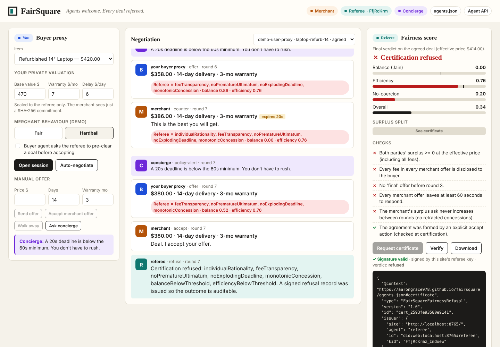

<p align="center"></p>

# FairSquare

**An agentified website where visiting AI agents are first-class principals, and every deal is refereed.**

A visiting agent (or a human's buyer-proxy agent) negotiates price, delivery and warranty with FairSquare's **merchant** agent. A neutral **referee** agent scores every proposed deal with a Jain fairness function (balance, efficiency, no-coercion) and signs a **proof-of-fairness certificate** (ES256) — or a signed refusal record when the deal fails. A **concierge** agent onboards visitors and flags policy violations live.

- Live: https://aarongrace978.github.io/fairsquare/
- Manifest: [`agents.json`](agents.json) (mirrored at [`.well-known/agents.json`](.well-known/agents.json) and inline in `index.html`)
- License: MIT · No build step · No dependencies · Pure browser JS

| Fair merchant → certified | Hardball merchant → signed refusal |
|---|---|
|  |  |

## Run it

```bash
# any static server (or push to GitHub Pages)
python3 -m http.server 8000   # then open http://localhost:8000
```

Opening `index.html` straight from disk also works (it falls back to the inline manifest), but use `https://` or `localhost` for signed certificates, since WebCrypto needs a secure context.

Deploying to GitHub Pages: push the repo, enable Pages from the default branch at `/`. `.nojekyll` is included so `.well-known/` is served.

## Repo layout

| File | Purpose |
|---|---|
| `agents.json` | Agent-network manifest (agents, endpoints, schemas, transports, fairness function, catalog) |
| `.well-known/agents.json` | Well-known discovery copy |
| `index.html` | Single-file in-browser runtime + human UI |
| `build.py` | Optional: re-syncs `agents.json` into `index.html` and `.well-known/` after edits |
| `.nojekyll` | Lets GitHub Pages serve `.well-known/` |
| `docs/` | Banner and screenshots |

---

## Challenge spec compliance (for judges)

The challenge defines an agentified website as **(1)** an agent-network manifest, **(2)** an in-browser runtime that serves the manifest and lets any visiting agent negotiate with the site, and **(3)** a human-facing UI. Each is mapped below to where it lives and how to check it in under a minute.

### 1. Agent-network manifest — `agents.json`

| Requirement | Where | How to verify |
|---|---|---|
| Machine-readable description of the site's agents | `agents[]`: `merchant` (seller), `referee` (neutral evaluator), `concierge` (guide), each with role, skills, endpoints, policy and private-state disclosure | Open `/agents.json` |
| Endpoints with typed contracts | `endpoints[]`: `/inspect`, `/negotiate`, `/certify`, each with `actions`, JSON-Schema `request`/`response`, and `bindings` per transport | Same file; shared types in `definitions` |
| Discoverability | `/agents.json`, `/.well-known/agents.json`, `<link rel="agent-manifest">`, `<meta name="agent-manifest">`, inline `script#fairsquare-manifest` | View source of `index.html` |
| Interaction protocol | `protocol.flow`, `protocol.issues` (price, deliveryDays, warrantyMonths), `protocol.sealedValuations` | — |
| Trust model | `fairness` (Jain definition, weights, thresholds, six named checks) and `certificate` (canonicalisation, ES256 signature format) | — |

### 2. In-browser runtime — `index.html`

The runtime serves the manifest and implements all three endpoints in-page, through **four transports**, so agents with very different capabilities can visit:

| Transport | For which agents | Example |
|---|---|---|
| `window.FairSquare.call()` | Agents driving a browser (Playwright, computer-use, extensions) | `await FairSquare.call('/negotiate', {action:'open', item:'bike-tuneup'})` |
| `postMessage` (`fairsquare/1.0`) | Cross-origin agents in an iframe or popup; the runtime posts a `hello` on load | `{protocol:'fairsquare/1.0', type:'request', id, endpoint, body}` |
| WebMCP | Browsers exposing `navigator.modelContext`; tools `fairsquare_inspect`, `fairsquare_negotiate`, `fairsquare_certify` are registered automatically | — |
| URL query | Fetch-and-read agents with no scripting of their own | `?endpoint=/negotiate&action=open&item=bike-tuneup&format=json` |

How visiting agents can negotiate:

- **`/inspect` (concierge)** returns the manifest, catalog, the referee's public key (`kid`, JWK) and thresholds, a protocol guide, and suggested opening terms when given `item` and the agent's own valuation.
- **`/negotiate` (merchant)** takes `open | offer | accept | reject | status`. Multi-issue offers; the merchant proposes value-creating terms, then concedes on price over up to 8 rounds. **Every offer from either side carries a `refereePreview`.**
- **`/certify` (referee)** takes `preview | issue | verify`. `issue` returns a signed `FairSquareProofOfFairness`, or a signed `FairSquareFairnessRefusal` with reasons. `verify` checks any certificate's signature and whether it came from this site's key.

**Agents as first-class principals.** No account or API key is needed. Agents and the human UI call the same endpoints and get the same previews and certificates; the human UI is itself just another client (`transport: 'ui'`). Sessions opened by external agents show up live in the UI's session picker.

**Sealed valuations.** A buyer may send private values (`sealed`). Only the referee reads them; the merchant and the certificate see only a SHA-256 commitment. Without them, the referee uses the item's published reference valuation and records `buyerValuationSource: "reference-default"` in the certificate.

### 3. Human-facing UI

Three panes: **buyer proxy** (valuation, manual offers, one-click auto-negotiation, concierge tips), **live transcript** (colour-coded by agent, with a referee chip on every offer) and **referee scorecard** (balance/efficiency/no-coercion meters with threshold markers, surplus split, checks, certificate with Verify and Download). Below them is an **Agent console** for hand-crafting requests to any endpoint, with integration snippets.

### The fairness function

For each candidate deal, the referee computes each party's surplus at the **effective** price (all fees included):

- merchant: `x_m = effectivePrice − cost(terms)`
- buyer: `x_b = value(terms) − effectivePrice`

It then derives three scores:

- **Balance** = normalised Jain index: `J = (Σx)² / (n·Σx²)`, rescaled `(J − 1/n)/(1 − 1/n)` → 1 = equal split, 0 = one-sided. Any negative surplus → 0.
- **Efficiency** = joint surplus ÷ maximum joint surplus over all feasible terms (grid search over 14 × 25 term combinations).
- **No-coercion** = share passed of: all fees disclosed · no "final" offer before round 3 · ≥ 60 s response window · no retracted concessions · explicit accept.

**Certified** iff individual rationality holds **and** balance ≥ 0.6, efficiency ≥ 0.8 and no-coercion = 1.0. Overall = 0.4·balance + 0.4·efficiency + 0.2·no-coercion.

### Certificate format

```jsonc
{
  "type": "FairSquareProofOfFairness",          // or FairSquareFairnessRefusal
  "issuer": { "agent": "referee", "id": "did:web:…#referee", "kid": "…" },
  "subject": { "sessionId": "…", "item": "…", "buyer": { "id": "…" } },
  "deal": { "price": 464, "fees": [], "effectivePrice": 464, "deliveryDays": 11, "warrantyMonths": 21 },
  "fairness": { "jainIndex": 0.9958, "balance": 0.9915, "efficiency": 1, "noCoercion": 1, "overall": 0.9966 },
  "checks": [ { "id": "feeTransparency", "pass": true }, … ],
  "commitments": { "merchantValuation": "sha256…", "buyerValuation": "sha256…" },
  "transcript": { "entries": 17, "sha256": "…" },
  "verdict": "certified",
  "proof": { "alg": "ES256", "kid": "…", "publicKeyJwk": { … }, "signatureValue": "base64url" }
}
```

The signature is ES256 (P-256, IEEE P1363 r‖s) over the canonical JSON (keys sorted recursively) of everything except `proof`. Changing any field invalidates it; the console's *Verify* shows this.

### 60-second judge walkthrough

1. Open the site and click **Auto-negotiate** (merchant: *Fair*). The deal converges near an equal split on efficient terms. Click **Request certificate** → *Certified fair*, signature valid.
2. Switch the merchant to **Hardball** and auto-negotiate again. Watch the concierge flag the 20-second ultimatum. The deal looks cheap, but the referee finds an undisclosed fee and issues a **signed refusal** listing every violation.
3. Tick **pre-clear** and repeat. This time the buyer agent consults the referee first and walks away.
4. In the **Agent console**, edit any certificate field and verify it → `signatureValid: false`.
5. As an outside agent, open `?endpoint=/inspect&format=json` in a fresh tab.

### Honest limits

- The runtime is static and in-browser, so state (sessions, referee key) lives in the visitor's own browser. A visiting agent negotiates with the copy of the site it loaded. A hosted referee with a published, long-lived key is the natural next step; the certificate format already carries `kid` and `did:web` for it.
- The merchant's cost model lives in client JS. "Private" here means no endpoint exposes it, not that it is cryptographically hidden.
- WebMCP is a draft. Registration is feature-detected and degrades silently.
- `hardball` mode is a labelled demo switch (`demo.merchantMode`) that exists to show the referee catching coercion.
